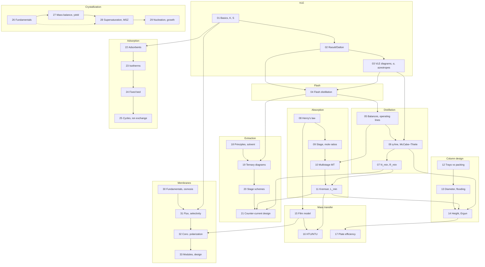

## Topic map

The equilibrium-stage idea runs through the whole course. VLE (01–03) gives the equilibrium line, and flash (04) is one stage. Distillation, absorption and counter-current extraction stack stages and solve them with McCabe–Thiele or Kremser (05–11, 20–21). Column design and mass transfer then turn the number of stages into a diameter and a height (12–17). The minimum-flow "pinch" idea repeats three times: R_min (07), L_min (11) and S_min (21). The ratio-of-K selectivity idea from 01 comes back in adsorption (22–23) and membranes (31). The lever rule (04) comes back on ternary diagrams (19).

**Recommended reading order for the exam (by weight):** 01 → 02 → 03 → 05 → 06 → 07 → 08 → 09 → 11 → 10 → 04 → 13 → 14 → 12 → 19 → 21 → 18 → 20 → 23 → 24 → 22 → 25 → 26 → 27 → 28 → 29 → 31 → 32 → 30 → 33 → 17 → 16 → 15.

**Exercise coupling:** Ex. 1 → 02–04. Ex. 2 → 05–07. Ex. 3 → 08–11. Ex. 4 → 12–14. Ex. 5 → 11, 14, 16, 17. Ex. 6 → 18–21. Ex. 7 → 23–25. Ex. 8 → 26–27. Ex. 9 → 30–32. The student's own answers (`Øving N Ferdig`) are deliberately not linked.
